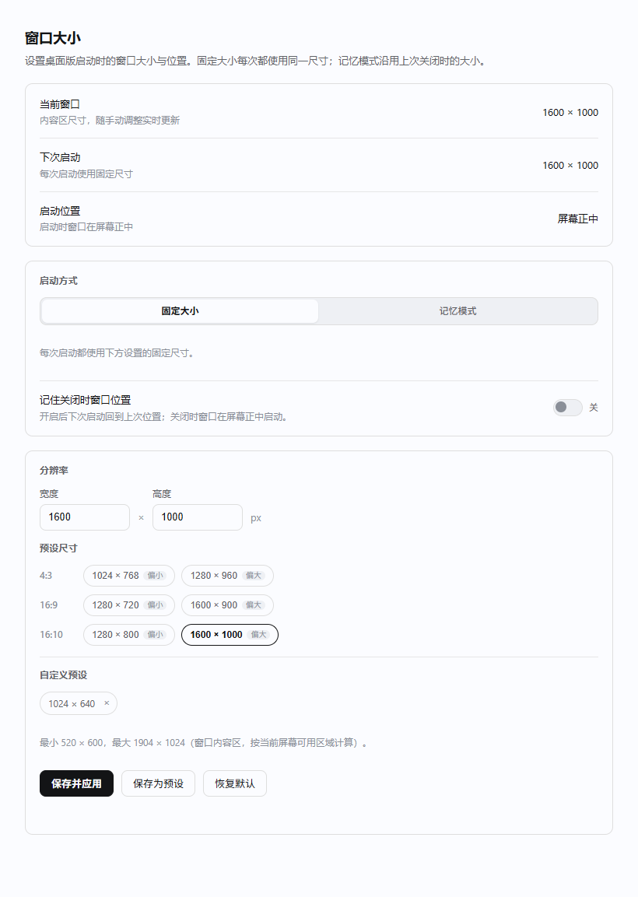

# dsh-window-size

**让 DeepSeek Harness 桌面版按你设定的尺寸和位置启动。**

[English](README.en.md) · [更新日志](CHANGELOG.md)

[](https://www.npmjs.com/package/dsh-window-size)
[](LICENSE)
[](https://github.com/jue5hen/dsh-window-size/actions/workflows/validate.yml)




DSH 桌面版每次启动固定为 **1280×820**，不会记住你调整过的窗口大小或位置：代码里 `createWindow` 写死了尺寸，也没有保存/恢复窗口 bounds 的逻辑。这个插件补上这一块——在设置面板里选择启动模式、保存尺寸和位置，页面启动阶段按保存值调整窗口，下次打开就是你要的样子。

## 功能

- **固定大小模式**：每次启动都使用保存的尺寸；保存后立即应用。
- **记忆模式**：下次启动沿用上次关闭（或隐藏到托盘）时的内容区大小，手动缩放后自动记录。
- **记住关闭时窗口位置**：开启后下次启动回到上次位置；关闭时默认在屏幕正中启动。位置越界（分辨率变化、副屏拔掉）会自动回退居中。
- **比例预设**：4:3 / 16:9 / 16:10 各一大一小，共 6 个内置尺寸；超出当前屏幕可用区域的预设会自动禁用。
- **自定义预设**：任意合法宽高都能保存为预设，最多 12 个，可删除，跨重启保留。
- **实时当前尺寸**：面板显示当前窗口内容区大小，随手动缩放更新。
- **保存并应用 / 恢复默认**：立即调整当前窗口；恢复默认会回到固定大小模式、1280×820、居中、不记忆位置，自定义预设保留。
- **仅桌面版生效**：在浏览器里打开 DSH 时面板只读，并提示该功能仅用于桌面应用。

## 安装

前置条件：DSH 桌面版（Electron 壳），运行时满足 `engines.dsh` 要求（`^0.2.1-rc.5`，已在 0.2.1-rc.5 上实测）。运行时版本不满足时，宿主会在 pnpm 之前就拒绝安装，并给出兼容性豁免入口。

### 从 npm 安装（推荐）

包发布在 [npm](https://www.npmjs.com/package/dsh-window-size)，安装直接拉取预构建产物，不克隆仓库、不执行构建脚本：

1. 在 DSH 会话里安装（省略版本号即取最新发布版）：

   ```text
   plugin_manager install_bundle dsh-window-size@1.1.0
   ```

2. **完全退出并重启** DSH（包括托盘里的进程）。首次安装或升级后，必须重启才能加载新的 Client 模块。

桌面版也可以在应用内 **设置 → 插件** 里搜索 `dsh-window-size` 安装；装了 dshmarket 等市场插件时，站内商店搜同一个名字即可。桌面档案由 Electron 壳管理，不需要命令行。

Web 档案（`dsh web`）可以用 CLI：

```bash
dsh plugin add dsh-window-size            # 默认档案，可加 --profile <name>
```

### 从源码安装（开发）

1. 克隆仓库到任意目录：

   ```bash
   git clone https://github.com/jue5hen/dsh-window-size.git
   ```

2. 在 DSH 会话里安装（把路径换成本机绝对路径）：

   ```text
   plugin_manager install_bundle file:/absolute/path/to/dsh-window-size
   ```

   Windows 路径示例：`file:D:/tools/dsh-window-size`。

3. 同样需要**完全退出并重启**。

`file:` 安装把整个检出目录链接进档案，`files` 白名单不生效（`node_modules/`、截图等也会一并带进去）；npm 安装只落地包内文件。两种方式都会把插件写进 `desktop` 档案的 `package.json` 与 `dsh.profile.bundles`。插件本身不写任何文件、不联网。

## 使用

1. 重启后打开 **左下角账号菜单 → 设置 → 窗口大小**。
2. 在「启动方式」里选 **固定大小** 或 **记忆模式**：
   - 固定大小：选一个预设或输入宽高，点 **保存并应用**；
   - 记忆模式：下次启动自动沿用上次关闭时的大小，无需再保存尺寸。
3. 需要恢复上次位置时，打开 **记住关闭时窗口位置**；关闭开关则每次启动居中。
4. 想复用的尺寸点 **保存为预设**；点预设右侧的 **×** 可删除。
5. **恢复默认**：回到固定大小模式、**1280×820**、居中、不记忆位置，自定义预设保留。

## 实现方式

Host 注入脚本 + Client 设置页，对应用影响最小：

- Host 半边 `index.js` 不注册服务、不写文件：它订阅 `webserver/index-inject`，往启动注入表推一段内联脚本。
- 注入脚本在页面启动、窗口显示前读取 `localStorage`，校验尺寸和位置后应用，因此启动时不会先显示默认尺寸再跳转；Client 模块只负责设置页、预设与写盘。
- `window.resizeTo` 设置的是**窗口内容区**尺寸（`innerWidth` / `innerHeight`），与应用自身 `BrowserWindow({ width: 1280, height: 820 })` 的语义一致；实际外框会多出窗口边框（Windows 上约 16×8）。
- 应用位置时按 `resizeTo` → `moveTo` → `resizeTo` 三步执行：Electron 44 的 `moveTo` 会按当前内容高度夹取 y 并把内容区临时放大一帧，先切到目标尺寸腾出空间，再移动（x 预先加 8 px 抵消边框偏移），最后复位尺寸，窗口才能准确落在目标坐标。
- 位置按内容区坐标保存：`x = screenX + 边框/2`，`y = screenY`；居中时按内容区中心计算，并夹在当前屏幕可用区域内。
- 运行期记录：窗口缩放后 600 ms 防抖保存尺寸；窗口隐藏、失焦、页面卸载时保存位置；可见时每 1 秒轮询一次位置（仅在开启位置记忆时写盘），启动后最多做 2 次位置/尺寸校正，用户一旦操作立即停止校正。
- 尺寸、模式和位置只存在本机 `localStorage['dsh-window-size:v2']`，随应用数据目录走，不上传、不影响其他插件。
- 存储格式：

  ```json
  {
    "mode": "fixed",
    "width": 1280,
    "height": 960,
    "last": { "width": 1400, "height": 900 },
    "rememberPosition": true,
    "position": { "x": 300, "y": 180 },
    "presets": [
      { "width": 1100, "height": 700 }
    ]
  }
  ```

  `mode` 为 `"fixed"`（缺省）或 `"memory"`；`width` / `height` 是固定模式尺寸，`last` 是记忆模式最后尺寸，`position` 是内容区左上角。`width` / `height` 可省略（表示使用应用默认尺寸）；旧版 `dsh-window-size:v1`（只有 `{width,height}`）在启动时仍会读取，首次保存时自动迁移到 v2 并删除旧键。旧版读到新记录会忽略未知字段，仍按固定尺寸工作。
- 边框测量兜底：窗口隐藏或最小化时，Chromium 可能报告错误的边框差值（甚至为负），插件只接受合理范围并沿用最近一次有效测量（兜底 16×8），避免把最大尺寸误算成整块屏幕。
- 边界：最小 **520×600**，最大为当前屏幕可用区域减去窗口边框，硬上限 **10000**。

## 兼容性

- **已验证**：Windows 11、DSH 0.2.1-rc.5、Electron 44.7.0（Chrome 152），屏幕可用区 1920×1032。
- **macOS / Linux 桌面版**：使用同一套 Electron 与 DOM API，理论上可用，但尚未实测。
- **Web 版**（浏览器打开 DSH）：插件会加载，但面板只读并提示仅桌面版可用。
- 不依赖其他插件，也不修改 DSH 安装目录。
- 多显示器：位置与尺寸上限按窗口当前所在屏幕（启动时通常为主屏）计算；保存在副屏的位置可能回退居中。
- 已知限制：冷启动非常早期的第一帧仍可能短暂显示应用默认尺寸（壳在页面 `load` 时就把窗口显示出来），要彻底消除需要改 Electron 壳本身。

## 常见问题

**改了尺寸，重启后没变化？**
插件安装或升级后需要完全退出重启。只把窗口关到托盘不算重启。

**为什么窗口外框比输入值大？**
设置的是内容区。Windows 上外框会比内容区宽约 16 px、高约 8 px。

**最大能设多大？**
当前屏幕可用区域减去窗口边框。硬上限 10000，超过会被拦截并提示。

**会影响其他插件吗？**
不会。只写自己的 `localStorage` 键，只注册一个设置页，Host 半边不注册任何服务。

**卸载后残留数据怎么办？**
删掉插件后残留的键会被忽略。想彻底清除，可在应用数据目录里清掉对应的站点存储。

**会记住窗口位置吗？**
默认不会，只保存尺寸并居中。开启「记住关闭时窗口位置」后会保存内容区坐标，下次启动回到上次位置；关闭开关会立即清除已保存的位置。

## 开发与校验

```text
dsh-window-size/
├─ package.json        bundle 清单（dsh.bundle.patch + dsh.client）
├─ cordis.patch.yml    插入一行 dsh-window-size（Host 半边）
├─ index.js            Host 半边：推送启动引导脚本
├─ client.js           Client 半边：设置页 + 预设 + 启动应用尺寸
├─ locale/zh.json      面板标题/描述
├─ locale/en.json
├─ icon.svg
├─ assets/icon-180.png  商店图标（GitHub 托管的位图）
├─ docs/screenshot.png
├─ screenshots.json     商店截图清单
├─ scripts/validate.mjs 发布前校验（清单 / 图标 / 实际打包内容）
├─ .github/workflows/   validate.yml（CI 校验）· publish.yml（npm 发布）
├─ README.md / README.en.md
├─ CHANGELOG.md
└─ LICENSE
```

提交前本地校验（语法、JSON、清单、图标、`npm pack` 实际清单）：

```bash
npm run validate
```

`npm publish` 会通过 `prepublishOnly` 自动重跑一次，校验不过不会发出包。`.github/workflows/validate.yml` 在每次 push / PR 跑同样的检查；`.github/workflows/publish.yml` 在推送 `v*` 标签时先校验标签与 `package.json` 版本一致，再带 provenance 发布到 npm。

发布新版本：把 `package.json` 与 `CHANGELOG.md` 的版本改成同一个号，提交后推标签：

```bash
git tag v1.1.0
git push origin v1.1.0
```

## 版本

见 [CHANGELOG.md](CHANGELOG.md)。当前版本 **1.1.0**。

## 许可证

[MIT](LICENSE)
