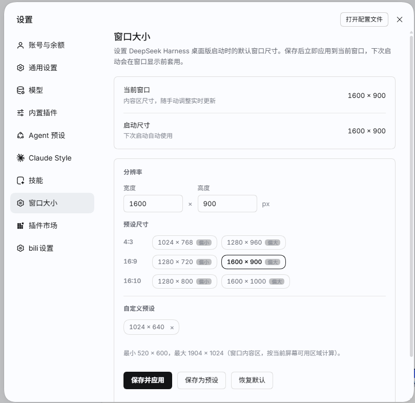

# dsh-window-size

**让 DeepSeek Harness 桌面版按你设定的尺寸启动。**

[English](README.en.md) · [更新日志](CHANGELOG.md)

[](LICENSE)
[](https://github.com/jue5hen/dsh-window-size/actions/workflows/validate.yml)




DSH 桌面版每次启动固定为 **1280×820**，不会记住你调整过的窗口大小：代码里 `createWindow` 写死了尺寸，也没有保存/恢复窗口 bounds 的逻辑。这个插件补上这一块——在设置面板里保存启动尺寸，页面启动阶段按保存值调整窗口，下次打开就是你要的大小。

## 功能

- **启动默认尺寸**：保存后立即应用，并在下次启动时自动生效。
- **比例预设**：4:3 / 16:9 / 16:10 各一大一小，共 6 个内置尺寸；超出当前屏幕可用区域的预设会自动禁用。
- **自定义预设**：任意合法宽高都能保存为预设，最多 12 个，可删除，跨重启保留。
- **实时当前尺寸**：面板显示当前窗口内容区大小，随手动缩放更新。
- **保存并应用 / 恢复默认**：立即调整当前窗口；恢复默认只清除启动尺寸，自定义预设保留。
- **仅桌面版生效**：在浏览器里打开 DSH 时面板只读，并提示该功能仅用于桌面应用。

## 安装

前置条件：DSH 桌面版（Electron 壳），已在 **0.2.1-rc.5** 上验证。

1. 克隆仓库到任意目录：

   ```bash
   git clone https://github.com/jue5hen/dsh-window-size.git
   ```

2. 在 DSH 会话里安装（把路径换成本机绝对路径）：

   ```text
   plugin_manager install_bundle file:/absolute/path/to/dsh-window-size
   ```

   Windows 路径示例：`file:D:/tools/dsh-window-size`。

3. **完全退出并重启** DSH（包括托盘里的进程）。首次安装或升级后，必须重启才能加载新的 Client 模块。

安装会把插件作为 `file:` 依赖写进 `desktop` 档案的 `package.json`，并注册到 `dsh.profile.bundles`。插件本身不写任何文件、不联网。

## 使用

1. 重启后打开 **左下角账号菜单 → 设置 → 窗口大小**。
2. 选一个预设，或直接输入宽度、高度，点 **保存并应用**。
3. 想复用的尺寸点 **保存为预设**；点预设右侧的 **×** 可删除。
4. **恢复默认**：清除启动尺寸，窗口回到应用默认的 **1280×820**，自定义预设保留。

## 实现方式

纯 Client 插件，对应用影响最小：

- Host 半边 `index.js` 只有一个空的 `apply()`，不注册服务、不注入配置、不写文件。
- Client 模块在 `apply()` 阶段读取 `localStorage`，校验后调用 `window.resizeTo(width, height)`；保存时写回。
- `window.resizeTo` 设置的是**窗口内容区**尺寸（`innerWidth` / `innerHeight`），与应用自身 `BrowserWindow({ width: 1280, height: 820 })` 的语义一致；实际外框会多出窗口边框（Windows 上约 16×8）。
- 尺寸和预设只存在本机 `localStorage['dsh-window-size:v2']`，随应用数据目录走，不上传、不影响其他插件。
- 存储格式：

  ```json
  {
    "width": 1280,
    "height": 960,
    "presets": [
      { "width": 1100, "height": 700 }
    ]
  }
  ```

  `width` / `height` 可省略（表示使用应用默认尺寸）；旧版 `dsh-window-size:v1`（只有 `{width,height}`）在启动时仍会读取，首次保存时自动迁移到 v2 并删除旧键。
- 边框测量兜底：窗口隐藏或最小化时，Chromium 可能报告错误的边框差值（甚至为负），插件只接受合理范围并沿用最近一次有效测量（兜底 16×8），避免把最大尺寸误算成整块屏幕。
- 边界：最小 **520×600**，最大为当前屏幕可用区域减去窗口边框，硬上限 **10000**。

## 兼容性

- **已验证**：Windows 11、DSH 0.2.1-rc.5、Electron 44.7.0（Chrome 152），屏幕可用区 1920×1032。
- **macOS / Linux 桌面版**：使用同一套 Electron 与 DOM API，理论上可用，但尚未实测。
- **Web 版**（浏览器打开 DSH）：插件会加载，但面板只读并提示仅桌面版可用。
- 不依赖其他插件，也不修改 DSH 安装目录。

## 常见问题

**改了尺寸，重启后没变化？**
插件安装或升级后需要完全退出重启。只把窗口关到托盘不算重启。

**为什么窗口外框比输入值大？**
设置的是内容区。Windows 上外框会比内容区宽约 16 px、高约 8 px。

**最大能设多大？**
当前屏幕可用区域减去窗口边框。硬上限 10000，超过会被拦截并提示。

**会影响其他插件吗？**
不会。只写自己的 `localStorage` 键，只注册一个设置页，Host 半边不注册任何服务。

**卸载后残留数据怎么办？**
删掉插件后残留的键会被忽略。想彻底清除，可在应用数据目录里清掉对应的站点存储。

**会记住窗口位置吗？**
不会，只保存尺寸。

## 开发与校验

```text
dsh-window-size/
├─ package.json        bundle 清单（dsh.bundle.patch + dsh.client）
├─ cordis.patch.yml    插入一行 dsh-window-size（Host 半边）
├─ index.js            Host 半边：空 apply()
├─ client.js           Client 半边：设置页 + 预设 + 启动应用尺寸
├─ locale/zh.json      面板标题/描述
├─ locale/en.json
├─ icon.svg
├─ assets/icon-180.png  商店图标（GitHub 托管的位图）
├─ docs/screenshot.png
├─ screenshots.json     商店截图清单
├─ README.md / README.en.md
├─ CHANGELOG.md
└─ LICENSE
```

提交前可本地校验：

```bash
node --check client.js
node --check index.js
node -e "for (const f of ['package.json','locale/zh.json','locale/en.json']) JSON.parse(require('fs').readFileSync(f,'utf8')); console.log('json ok')"
```

仓库自带 GitHub Actions（`.github/workflows/validate.yml`），在每次 push / PR 时跑同样的检查。

## 版本

见 [CHANGELOG.md](CHANGELOG.md)。当前版本 **1.0.1**。

## 许可证

[MIT](LICENSE)
